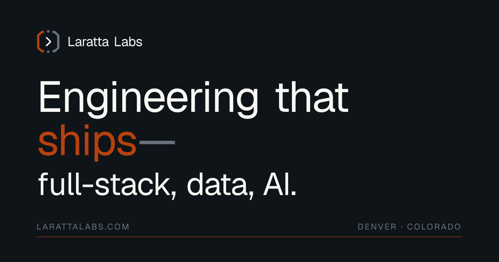

  

Laratta Labs is an AI-native software studio in Denver, run by [Noah Laratta](https://github.com/nlaratta). It builds full-stack apps, the cloud infrastructure and data pipelines behind them, and AI systems, and ships them to production end to end. It's also where the studio's own products come from.

**[larattalabs.com](https://larattalabs.com)** · Have a project? [Start here](https://larattalabs.com/contact/)

### Products

- **SquadUp:** a social fitness platform. Find local workouts, train together, and let hosts get paid. [App Store](https://apps.apple.com/us/app/squadup-lift-more-together/id6745851197) · [supsquadup.com](https://supsquadup.com)
- **YardPaint:** photograph your yard, paint zones, and get a photorealistic landscaped preview with the plants to make it real. [App Store](https://apps.apple.com/us/app/yardpaint/id6781556965) · [yardpaint.app](https://yardpaint.app)

### Open source

| Project | What it is |
|---|---|
| [**Architect**](https://github.com/larattalabs/architect-mc) | Design Minecraft buildings with Claude, review them as a ghost in your world, and build them in survival. Fabric mod. |
| [**Local Lab**](https://github.com/larattalabs/local-lab) | Desktop playground for comparing local AI models on Apple Silicon: image, video, music and text. |
| [**Hunyuan3D for Blender on Mac**](https://github.com/larattalabs/blender-hunyuan3d-mac) | Textured 3D asset generation inside Blender, entirely on Apple Silicon. No CUDA, no cloud. |
| [**lab-ui**](https://github.com/larattalabs/lab-ui) | Shared Fabric client UI library for the studio's Minecraft mods. |
| [**Steward**](https://github.com/larattalabs/steward-mc) | A Claude-driven NPC that plans and builds your Minecraft settlement. Early planning stage. |
